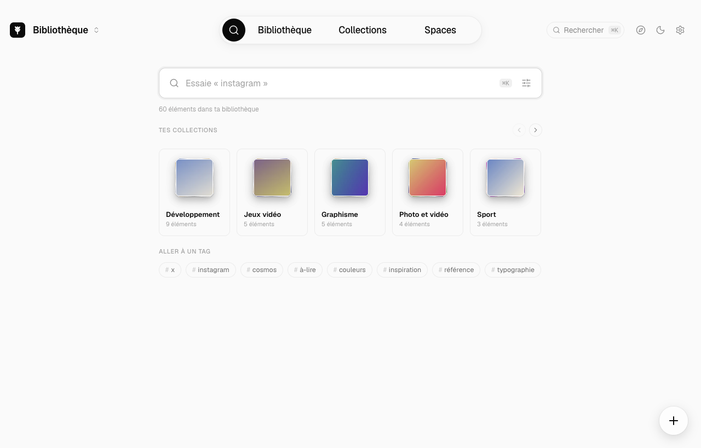

<p align="center">
  
</p>

<h1 align="center">RecoltOS</h1>

<p align="center">
  <strong>Ta bibliothèque d'inspiration visuelle, sur ton Mac.</strong><br>
  Images, vidéos, pages web, captures d'écran et posts enregistrés, rangés dans une seule app rapide, belle et 100 % locale.
</p>

<p align="center">
  <a href="https://github.com/Senooy/RecoltOS/releases/latest"><strong>Télécharger pour macOS (Apple Silicon)</strong></a>
  ·
  <a href="#fonctionnalités">Fonctionnalités</a>
  ·
  <a href="#installation">Installation</a>
  ·
  <a href="#développement">Développement</a>
</p>

<p align="center">
  
</p>

> **English summary.** RecoltOS is a free, open-source, local-first visual inspiration library for
> macOS (Apple Silicon). Save images, videos, web pages, screenshots and bookmarked posts from X,
> Instagram and Cosmos, then browse them in a masonry grid, organize them in collections, rediscover
> them, and lay them out on free-form canvases. Everything stays on your Mac: no account, no cloud, no
> telemetry. Optional AI titles, descriptions and tags run through the `claude` / `codex` CLIs you
> already use. The interface is in French. MIT licensed.

---

## Pourquoi RecoltOS

On passe ses journées à croiser des choses qu'on veut garder : une interface bien pensée sur X, un reel
Instagram, une affiche, une palette, une capture d'écran. Elles finissent éparpillées entre les favoris
de trois réseaux, un dossier de captures et des onglets jamais refermés.

RecoltOS les **récolte** au même endroit, et en fait une bibliothèque qu'on a envie d'ouvrir :

- **Tout est local.** Tes fichiers et ta base restent sur ton disque. Pas de compte, pas de serveur,
  pas d'abonnement, pas de télémétrie.
- **L'image d'abord.** L'interface s'efface : grille dense, vue détail immersive dont l'ambiance se
  teinte aux couleurs du média, animations discrètes.
- **Rapide.** Démarrage sous la seconde, défilement fluide à 60 images/s, recherche instantanée même sur
  10 000 éléments.
- **Ouvert.** Code source sous licence MIT, format de données documenté (SQLite), export zip complet à
  tout moment.

## Fonctionnalités

### Collecter

- **Glisser-déposer** de fichiers ou de dossiers entiers, **coller** une image ou une URL (⌘V),
  « Ouvrir avec RecoltOS » depuis le Finder.
- **Capture d'écran** globale (⌘⇧S) : zone, fenêtre ou plein écran, directement dans la bibliothèque.
- **Extension navigateur** pour Firefox et Chrome / Brave / Edge / Vivaldi : clic droit sur une image,
  une vidéo, un lien ou une page › « Enregistrer dans RecoltOS ».
- **Synchronisation** (facultative) de tes **favoris X**, de tes **enregistrements Instagram** et de tes
  **saves Cosmos**, en arrière-plan, sans onglet ouvert, tant que ton navigateur tourne.
- **Import depuis GatherOS** : si tu utilises GatherOS, RecoltOS reprend ta bibliothèque existante
  (éléments, collections, tags, notes) sans modifier l'originale.

### Organiser

- **Grille masonry** avec onglets Tout, Enregistrés, Non classés, Corbeille et Masqués, tri, taille de
  colonnes réglable.
- **Collections** et sous-collections, présentées dans une **étagère 3D** ; glisse une carte et le
  panneau des collections s'ouvre pour l'y déposer.
- **Tags**, notes, renommage, corbeille avec restauration, annulation (⌘Z) partout.

<p align="center">
  
  
</p>

### Retrouver et redécouvrir

- **Recherche plein texte** sur les titres, notes, textes des posts, texte lu dans les images et
  descriptions IA, avec filtres par type, source, période, collection et **couleur**.
- **Palette de commandes** ⌘K pour tout atteindre au clavier.
- **Vue détail** plein écran : lecteur vidéo, carrousels, carte du post d'origine, palette de couleurs,
  **pipette** pour copier une couleur de l'image.
- **Redécouvrir** (⌘⇧R) : une pile de cartes à trier au clavier ou en les glissant. Garder, ranger dans
  une collection, mettre à la corbeille.

<p align="center">
  
  
</p>

### Composer

- **Spaces** : des toiles infinies pour composer des moodboards. Notes de couleur, formes, texte libre,
  images et éléments de ta bibliothèque ; zoom, magnétisme, rotation, alignement, export PNG.

### Enrichir avec l'IA (facultatif)

- Titres, descriptions, tags et texte lu dans les images, générés par les CLI **`claude`** (Claude
  Code) ou **`codex`** (OpenAI) **de ton propre abonnement**. Aucune clé d'API, aucun modèle embarqué.
- Rien n'est envoyé sans ton consentement explicite ; aperçu exact de chaque envoi, budget d'appels par
  heure, journal consultable.

<p align="center">
  
</p>

_Toutes les captures sont faites sur une bibliothèque de démonstration entièrement factice._

## Installation

### Télécharger

1. Télécharge le fichier `.dmg` de la [dernière version](https://github.com/Senooy/RecoltOS/releases/latest)
   (Mac Apple Silicon, macOS 13 ou plus récent).
2. Ouvre le `.dmg` et glisse **RecoltOS** dans **Applications**.
3. L'app n'est pas notarisée par Apple : au premier lancement, macOS la bloque. Deux possibilités :
   - Réglages Système › Confidentialité et sécurité › « Ouvrir quand même » ;
   - ou, dans le Terminal :

     ```sh
     xattr -dr com.apple.quarantine /Applications/RecoltOS.app
     ```

4. Installe **ffmpeg**, utilisé pour les vignettes et aperçus vidéo :

   ```sh
   brew install ffmpeg
   ```

### Premiers pas

- **Capture d'écran** : fais ⌘⇧S, puis autorise RecoltOS dans Réglages Système › Confidentialité et
  sécurité › Enregistrement de l'écran, et relance l'app.
- **Extension navigateur** : l'app place l'extension dans
  `~/Library/Application Support/RecoltOS/extension/`. Détails et installation pour chaque navigateur
  dans [`docs/extension.md`](docs/extension.md).
  - Firefox : `about:debugging#/runtime/this-firefox` › « Charger un module complémentaire
    temporaire… » › `extension/firefox/manifest.json` (ou une version signée, voir la doc).
  - Chrome / Brave / Edge : `chrome://extensions` › Mode développeur › « Charger l'extension non
    empaquetée » › `extension/chromium/`.
- **Synchronisation** : reste connecté à X, Instagram ou Cosmos dans ton navigateur, puis Réglages ›
  Synchronisation.
- **IA** : installe et connecte `claude` ou `codex`, puis Réglages › IA › « Changer ».

### Construire depuis les sources

Prérequis : Mac Apple Silicon, Node 22.22+ ou 24.15+, pnpm 12.6 via corepack, ffmpeg.

```sh
corepack enable
export COREPACK_ENABLE_DOWNLOAD_PROMPT=0
pnpm install
RECOLTOS_SIGN_IDENTITY="RecoltOS Local" pnpm run pack   # → dist/mac-arm64/RecoltOS.app
pnpm run app:install                                     # copie dans /Applications et lance l'app
pnpm run dist:dmg                                        # → dist/RecoltOS-<version>-arm64.dmg
```

`RECOLTOS_SIGN_IDENTITY` est facultatif mais conseillé : avec un certificat de signature local stable,
macOS conserve les permissions (Enregistrement de l'écran) d'un build à l'autre. Création du certificat
en deux minutes : [`docs/signature.md`](docs/signature.md).

## Tes données

- Tout est dans `~/Library/Application Support/RecoltOS/` : base SQLite, médias et dérivés, Spaces,
  réglages.
- Réglages › Données : **export zip** complet, instantanés automatiques et restauration.
- L'interface n'a aucun accès réseau. L'app ne télécharge que les médias des posts synchronisés (option
  désactivable), et l'IA n'envoie que ce que tu as accepté, via tes propres CLI.

## Avertissements

- **Projet indépendant**, non affilié à X Corp., Meta / Instagram ou Cosmos. Les marques citées
  appartiennent à leurs propriétaires et ne servent qu'à désigner les services avec lesquels l'app
  interagit.
- **Synchronisation non officielle.** Elle passe par des requêtes web non officielles, émises par
  l'extension avec la session de **ton** navigateur. Elle peut **enfreindre les conditions
  d'utilisation** de ces services, entraîner des vérifications ou restrictions de ton compte, et cesser
  de fonctionner à tout moment. Elle est désactivée par défaut : tu l'actives **à tes propres risques**.
- **Aucune garantie.** Le logiciel est fourni « tel quel » (voir [`LICENSE`](LICENSE)). Fais des
  sauvegardes.

## Limites connues

- Apple Silicon uniquement ; interface en français.
- ffmpeg (Homebrew) est requis.
- La synchronisation ne tourne que navigateur ouvert ; Safari n'est pas pris en charge.
- X peut exiger un en-tête de requête signé que l'extension ne reproduit pas : dans ce cas, ouvrir une
  fois x.com/i/bookmarks récupère les favoris affichés.
- Pas de mise à jour automatique : télécharge les nouvelles versions depuis les Releases.

## Développement

```sh
pnpm run dev        # electron-vite : renderer Vite + main + preload
pnpm run dev:demo   # avec une bibliothèque de démonstration isolée
pnpm run verify     # format, lint, typecheck, tests unitaires, e2e, régression visuelle
```

Stack : Electron, React, TypeScript, Vite, Tailwind CSS, SQLite (better-sqlite3, FTS5), sharp,
ffmpeg, Playwright et Vitest. L'extension est en Manifest V3 et communique avec l'app par native
messaging (aucun port réseau ouvert).

| Script                          | Rôle                                                               |
| ------------------------------- | ------------------------------------------------------------------ |
| `verify:fast`                   | format, lint, typecheck, contrôle des dépendances, tests unitaires |
| `verify`                        | `verify:fast` + e2e + régression visuelle + garde des données      |
| `test:e2e` / `test:visual`      | Playwright sur l'app Electron                                      |
| `test:packaged`                 | app packagée : rendu et hôte natif                                 |
| `test:ext` / `test:ext:firefox` | extension dans un Chromium / un Firefox de test                    |
| `build:ext` / `sign:firefox`    | builds de l'extension / signature Firefox non répertoriée          |
| `pack` / `dist` / `dist:dmg`    | app signée, app + contrôles du paquet, image disque                |
| `app:install`                   | installation dans `/Applications`                                  |

Les tests n'utilisent jamais tes navigateurs, tes profils ni tes comptes : ils tournent sur une
bibliothèque de démonstration factice.

Documents : [`docs/extension.md`](docs/extension.md) · [`docs/signature.md`](docs/signature.md) ·
[`docs/perf.md`](docs/perf.md) · [`docs/checklist-manuelle.md`](docs/checklist-manuelle.md)

## Licence

[MIT](LICENSE) © 2026 Younes Khelifi.
