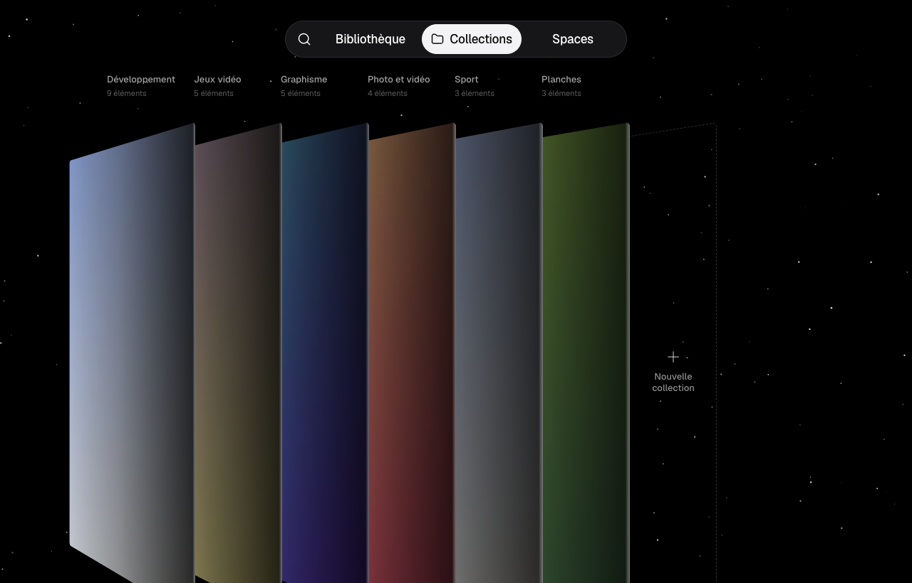

# RecoltOS

> **In English, in short.** RecoltOS is a local-first visual inspiration library for macOS (Electron,
> Apple Silicon). It keeps images, videos, web pages, screenshots and saved posts in a masonry grid,
> collections and free-form canvases ("Spaces"), entirely on your Mac, with no account and no
> telemetry. Optional AI tagging runs through the `claude` / `codex` command-line tools you already use.
> The interface is in French. RecoltOS is an independent project released under the MIT license; it is
> not affiliated with GatherOS, X Corp., Meta/Instagram or Cosmos. The optional sync relies on
> unofficial web requests made with your own browser session: it may break at any time and may go
> against those services' terms of use. Use it at your own risk.

RecoltOS est une **bibliothèque d'inspiration visuelle locale pour macOS** : images, vidéos, pages web,
captures d'écran et publications enregistrées (X, Instagram, Cosmos) rangées dans une grille, des
collections et des Spaces (toiles libres). Tout reste sur ton Mac : pas de compte, pas de télémétrie,
pas de mise à jour automatique. Interface en français.




_Captures issues des tests de régression visuelle, sur une bibliothèque de démonstration entièrement
factice._

## Avertissements

- **Projet indépendant.** RecoltOS n'est ni affilié, ni soutenu, ni approuvé par GatherOS, X Corp.,
  Meta / Instagram ou Cosmos. Les noms et marques cités appartiennent à leurs propriétaires respectifs
  et ne servent qu'à désigner les services avec lesquels l'app interagit.
- **Synchronisation non officielle.** La synchronisation des favoris X, des enregistrements Instagram
  et des éléments Cosmos passe par des requêtes web **non officielles**, émises par l'extension avec la
  session de **ton** navigateur. Elle peut **enfreindre les conditions d'utilisation** de ces services,
  entraîner des vérifications ou des restrictions de ton compte, et **cesser de fonctionner à tout
  moment** si ces sites changent. Elle est désactivée par défaut ; tu l'actives **à tes propres
  risques**.
- **Aucune garantie.** Le logiciel est fourni « tel quel » (voir [`LICENSE`](LICENSE)). Fais des
  sauvegardes de tes données.

## Fonctionnalités

- **Bibliothèque** : grille masonry, onglets (Tout, Enregistrés, Non classés, Corbeille, Masqués),
  tris, filtres, recherche plein texte locale (SQLite FTS5) et par couleur, vue détail (image, vidéo,
  post, carrousel), Redécouvrir, palette de commandes ⌘K, thèmes clair et sombre.
- **Collections** et sous-collections, étagère 3D ; **Spaces** : notes, formes, texte, éléments de la
  bibliothèque, export PNG.
- **Ajout** : glisser-déposer, coller (⌘V), URL, capture d'écran ⌘⇧S, « Ouvrir avec RecoltOS »,
  extension navigateur (clic droit › « Enregistrer dans RecoltOS »).
- **Synchronisation** (facultative, voir les avertissements) des favoris X, enregistrements Instagram
  et éléments Cosmos, par l'extension, en arrière-plan, sans onglet ouvert.
- **IA** (facultative) : nom, description, tags et texte détecté, produits par les CLI `claude` ou
  `codex` de tes propres abonnements.
- **Import depuis GatherOS** : Réglages › Bibliothèques › « Importer depuis GatherOS » copie les
  éléments, collections, tags et notes d'une bibliothèque GatherOS existante, sans la modifier.
- **Données** : export zip, instantanés et restauration.

## Prérequis

- macOS sur Apple Silicon (le build est `arm64`).
- Node `22.22.2+` ou `24.15.0+`, et pnpm 12.6.0 via corepack (`corepack enable`).
- `ffmpeg` et `ffprobe` (`brew install ffmpeg`) : vignettes et aperçus des vidéos.
- Facultatif mais conseillé : un certificat de signature local **« RecoltOS Local »** (voir plus bas),
  pour que macOS garde les permissions (Enregistrement de l'écran…) d'un build à l'autre.

`pnpm run check:env` vérifie l'environnement (Node, pnpm, ffmpeg, certificat).

## Installation et build

```sh
export COREPACK_ENABLE_DOWNLOAD_PROMPT=0
pnpm install
RECOLTOS_SIGN_IDENTITY="RecoltOS Local" pnpm run pack   # → dist/mac-arm64/RecoltOS.app, signé
pnpm run app:install                                     # copie dans /Applications et lance l'app
```

- Sans `RECOLTOS_SIGN_IDENTITY`, la signature est « ad hoc » (`-`) : l'app fonctionne, mais macOS
  redemande l'autorisation Enregistrement de l'écran après chaque nouveau build.
- `pnpm run dist` = contrôles rapides (`verify:fast`) + `pack` + vérification du paquet (`check:dist` :
  fuses, hôte natif signé, extensions embarquées).
- `app:install` vérifie la signature avant de remplacer l'app installée et ne touche jamais à tes
  données. Variables : `RECOLTOS_INSTALL_DIR` (défaut `/Applications`), `RECOLTOS_NO_OPEN=1`.
- L'app n'est pas notarisée : chacun la construit et la signe sur sa machine.

### Certificat « RecoltOS Local »

À créer une fois dans **Trousseau d'accès › Assistant de certification › Créer un certificat…** :
nom `RecoltOS Local`, type d'identité « Auto-signé racine », type « Signature de code », puis
« Se fier › Signature de code : Toujours approuver ». Vérification :
`security find-identity -v -p codesigning` doit lister `"RecoltOS Local"`.
Procédure détaillée et raisons : [`docs/signature.md`](docs/signature.md).

### Première utilisation

1. **Capture d'écran** : ⌘⇧S, puis autorise RecoltOS dans Réglages Système › Confidentialité et
   sécurité › Enregistrement de l'écran et de l'audio système, et relance l'app.
2. **Extension** et **synchronisation** : voir ci-dessous.
3. **IA** : Réglages › IA (voir plus bas).

## Extension navigateur (Firefox et Chromium)

Une base de code (`extension/`), deux builds : Firefox et Chromium (Chrome, Brave, Edge, Vivaldi).
L'extension parle à l'app par native messaging (aucun port réseau). L'app installée recopie les
extensions dans `~/Library/Application Support/RecoltOS/extension/{firefox,chromium}/` et écrit les
manifests `com.recoltos.host.json` des navigateurs présents.

- **Firefox, chargement temporaire** (disparaît au redémarrage de Firefox) :
  `about:debugging#/runtime/this-firefox` › « Charger un module complémentaire temporaire… » ›
  `~/Library/Application Support/RecoltOS/extension/firefox/manifest.json`.
- **Firefox, installation permanente** : Firefox release exige une extension signée. Avec tes propres
  identifiants d'API addons.mozilla.org (jamais écrits dans un fichier du dépôt) :

  ```sh
  export WEB_EXT_API_KEY='user:…'   # émetteur JWT
  export WEB_EXT_API_SECRET='…'     # secret JWT
  pnpm run build:ext && pnpm run sign:firefox      # → dist-extension/signed/*.xpi (non répertoriée)
  RECOLTOS_SIGN_IDENTITY="RecoltOS Local" pnpm run pack && pnpm run app:install
  ```

  puis glisse le `.xpi` dans une fenêtre Firefox. Chaque nouvelle signature exige une nouvelle version
  (`EXTENSION_VERSION`, `src/shared/bridge/constants.ts`).

- **Chrome / Brave / Edge** : `chrome://extensions` › Mode développeur › « Charger l'extension non
  empaquetée » › `~/Library/Application Support/RecoltOS/extension/chromium/`.

**Synchronisation** : reste connecté à X, Instagram ou Cosmos dans le navigateur, puis Réglages ›
Synchronisation › active la source (après avoir lu l'avertissement). La synchro tourne en arrière-plan
tant que le navigateur est ouvert, sans ouvrir d'onglet ; les cookies ne quittent jamais le navigateur
et l'app télécharge les médias sans cookie. Détails, autorisations Firefox et dépannage :
[`docs/extension.md`](docs/extension.md).

## IA via tes CLI `claude` / `codex`

RecoltOS n'utilise **aucune clé d'API** et n'embarque aucun modèle : il appelle les CLI officiels déjà
installés et connectés à ton abonnement (`claude` de Claude Code, `codex` d'OpenAI). Réglages › IA ›
« Changer » : choisis le moteur, lis et accepte le consentement ; rien n'est envoyé avant. Budget par
défaut de 120 appels par heure, moteur de secours facultatif, aperçu exact de chaque envoi et journal
dans Réglages › IA. Les CLI sont cherchés dans le PATH de ton shell interactif et dans les dossiers
d'installation courants. Les appels consomment ton quota et sont soumis aux conditions de ces services.

## Données locales

- Tout est sous `~/Library/Application Support/RecoltOS/` : `prefs.json`, `libraries.json`,
  `libraries/<id>/recolt.db` (SQLite), médias et dérivés, `spaces/`, `logs/`, `extension/`.
- Réglages › Données : export zip de la bibliothèque, instantanés et restauration.
- Rien n'est envoyé ailleurs : le renderer n'a aucun accès réseau (CSP sans `https:`) ; l'app ne
  télécharge que les médias et avatars des publications synchronisées (Réglages › Stockage, interrupteur
  « Télécharger les médias distants »), et l'IA n'envoie que ce que tu as accepté.

### Désinstallation

```sh
/Applications/RecoltOS.app/Contents/MacOS/RecoltOS --uninstall-native-hosts   # retire com.recoltos.host.json
rm -rf /Applications/RecoltOS.app
rm -rf ~/Library/Application\ Support/RecoltOS          # efface TOUTES tes données RecoltOS
tccutil reset ScreenCapture com.recoltos.app             # facultatif : oublie la permission
```

Retire aussi l'extension de tes navigateurs. Les fichiers des autres applications ne sont jamais
touchés.

## Limites connues

- **X** peut exiger un en-tête signé (`x-client-transaction-id`) que l'extension ne reproduit pas. Si
  la ligne X indique « X refuse la requête de l'extension », ouvre une fois x.com/i/bookmarks : les
  favoris affichés sont récupérés par la page.
- La synchro ne tourne que **navigateur ouvert** ; Safari n'est pas pris en charge.
- Instagram : budget strict (20 appels par synchro, 200 par jour) pour limiter les vérifications de
  compte, sans garantie.
- `ffmpeg` (Homebrew) est requis : l'app n'est pas portable telle quelle sur un Mac sans Homebrew.
- Apple Silicon seulement ; pas de recherche visuelle par embeddings ; pas de mise à jour automatique.
- Mémoire : une toile Spaces de 500 nœuds tient vers 0,5–0,7 Go d'empreinte ([`docs/perf.md`](docs/perf.md)).

## Développement

```sh
pnpm run dev                                  # electron-vite (Vite + main + preload)
pnpm run dev:demo                             # avec une bibliothèque de démonstration isolée
RECOLTOS_USER_DATA="$PWD/.tmp/userdata" pnpm run dev   # données isolées
```

Toujours `pnpm run <script>` (jamais `pnpm doctor` / `pnpm rebuild`, commandes intégrées de pnpm).

| Script                          | Rôle                                                                                 |
| ------------------------------- | ------------------------------------------------------------------------------------ |
| `verify:fast`                   | format, lint, typecheck, `check:pkg`, tests unitaires                                |
| `verify`                        | `verify:fast` + e2e + régression visuelle + garde des données (`guard`)              |
| `verify:full`                   | `verify` + `test:real` + `dist` + `test:packaged` + `test:perf`                      |
| `test:e2e` / `test:visual`      | Playwright sur l'app Electron (dont `tests/e2e/security.spec.ts`, parcours complet)  |
| `test:packaged`                 | app packagée : grille rendue, hôte natif                                             |
| `test:perf`                     | grille et toile Spaces ([`docs/perf.md`](docs/perf.md))                              |
| `test:ext` / `test:ext:firefox` | extension dans le Chromium de Playwright / dans Firefox (opt-in)                     |
| `build:ext` / `sign:firefox`    | builds de l'extension / signature Firefox `unlisted`                                 |
| `pack` / `dist` / `app:install` | paquet signé, paquet + contrôles, installation dans `/Applications`                  |
| `shots`                         | captures d'écran de l'app sur la bibliothèque de démo (`.visual/current/`)           |
| `guard`                         | échoue si une base SQLite, des réglages utilisateur ou un secret sont suivis par git |

Variables de test : `RECOLTOS_USER_DATA`, `RECOLTOS_E2E=1`, `RECOLTOS_WINDOW=1280x820`,
`RECOLTOS_HOME`. Les tests n'utilisent jamais tes navigateurs, tes profils ni tes comptes ; le parcours
e2e complet tourne sur une bibliothèque de démonstration, ou sur une copie désignée par
`RECOLTOS_E2E_REAL=<dossier>`.

## Documents

- [`docs/extension.md`](docs/extension.md) : extension, synchronisation, autorisations, tests.
- [`docs/signature.md`](docs/signature.md) : signature locale et permissions macOS.
- [`docs/perf.md`](docs/perf.md) : budgets et mesures de performance.
- [`docs/checklist-manuelle.md`](docs/checklist-manuelle.md) : checklist de test manuel.

## Licence

[MIT](LICENSE) © 2026 Younes Khelifi.
