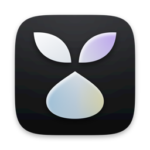
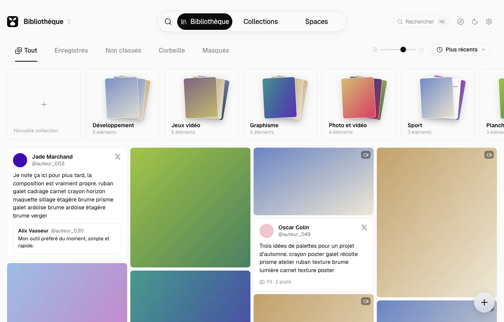
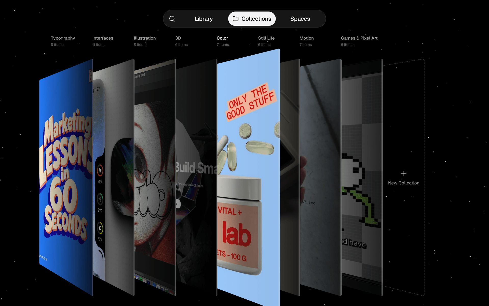
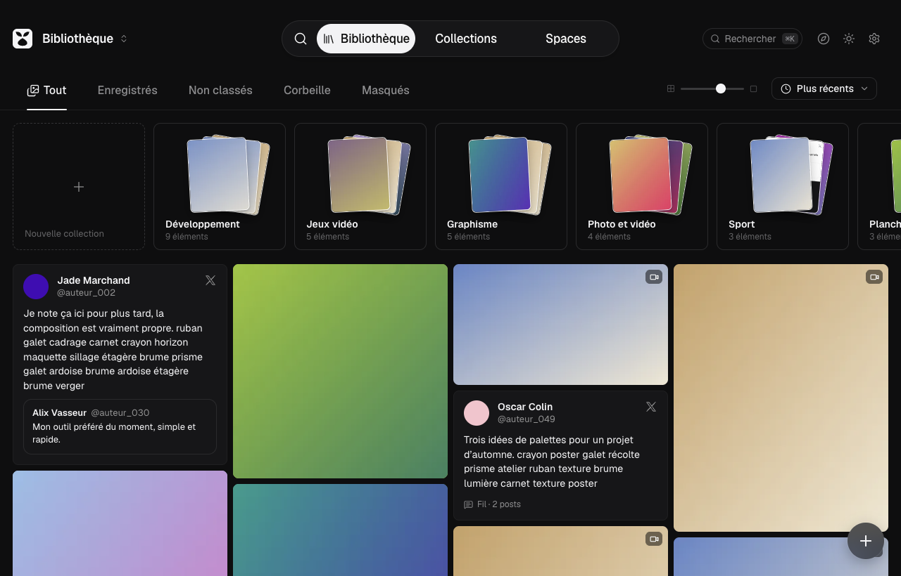
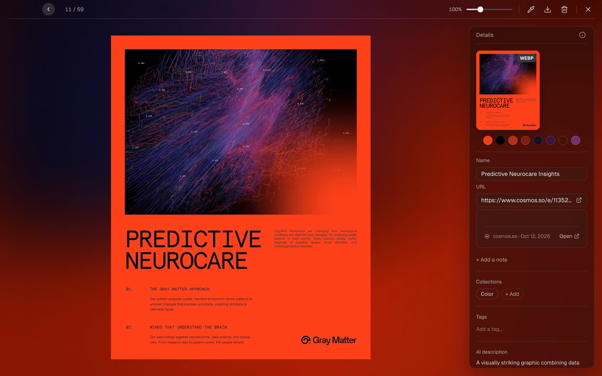
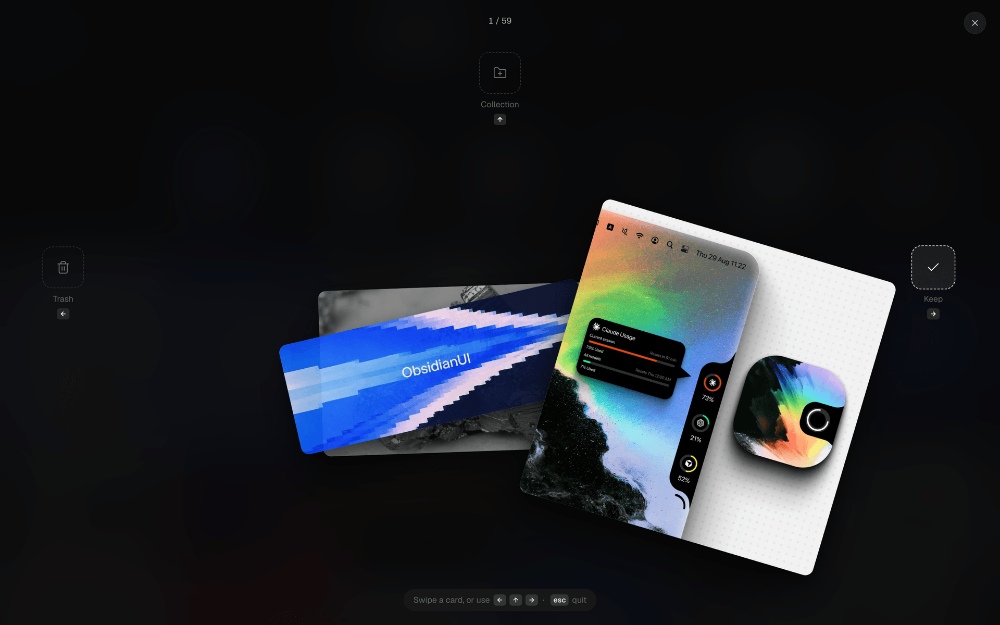

<p align="center">
  
</p>

<h1 align="center">RecoltOS</h1>

<p align="center">
  A local library for visual inspiration on macOS.<br>
  <a href="https://github.com/Senooy/RecoltOS/releases/latest">Download for Apple Silicon</a>
</p>



RecoltOS collects the images, videos, web pages, screenshots and saved posts you come across, and keeps
them in one place on your Mac. You browse them in a masonry grid, sort them into collections, search
them by text or color, and arrange them on free-form canvases.

There is no account and no server. Your files and the SQLite database live in
`~/Library/Application Support/RecoltOS`, and you can export everything as a zip at any time.

The interface is in French for now.

## Features

**Adding things**

- Drag and drop files or whole folders, paste an image or a URL, or use "Open with RecoltOS" in the
  Finder.
- Global screenshot shortcut (⌘⇧S) for a region, a window or the full screen.
- Browser extension for Firefox and Chromium browsers (Chrome, Brave, Edge, Vivaldi): right-click an
  image, video, link or page to save it.
- Optional background sync of your X bookmarks, Instagram saved posts and Cosmos saves, while your
  browser is open. See the [note on sync](#a-note-on-sync) below.
- Import an existing GatherOS library (items, collections, tags and notes). The original library is
  left untouched.

**Organizing**

- Masonry grid with All, Saved, Unsorted, Trash and Hidden tabs, sorting and adjustable column count.
- Collections and nested collections, shown as a 3D shelf. Dragging a card opens a side panel listing
  your collections so you can drop it into one.
- Tags, notes, renaming, trash with restore, and undo (⌘Z).

<p align="center">
  
  
</p>

**Finding things again**

- Full-text search across titles, notes, post text, text detected in images and AI descriptions, with
  filters for type, source, date, collection and color.
- Command palette (⌘K).
- Full-screen detail view with a video player, carousels, the original post, the color palette and an
  eyedropper. The background takes on the colors of the item you're looking at.
- Rediscover (⌘⇧R): a stack of cards you sort with the arrow keys or by dragging (keep, move to a
  collection, or trash).

<p align="center">
  
  
</p>

**Spaces**

- Infinite canvases for moodboards: sticky notes, shapes, text, images and items from your library.
  Zoom, snapping, rotation, alignment and PNG export.

**AI (optional)**

- Titles, descriptions, tags and OCR text, generated by the `claude` (Claude Code) or `codex` (OpenAI)
  command-line tools you already have and are signed in to. RecoltOS has no API keys and ships no
  model.
- Nothing is sent before you give consent. You can preview exactly what will be sent, set an hourly
  limit and read a log of every call.

The screenshots use a demo library with placeholder content.

## Install

1. Download the `.dmg` from the [latest release](https://github.com/Senooy/RecoltOS/releases/latest).
   It requires an Apple Silicon Mac running macOS 13 or later.
2. Open it and drag RecoltOS into Applications.
3. The app is not notarized by Apple, so macOS blocks it the first time. Either go to System Settings ›
   Privacy & Security and click "Open Anyway", or run:

   ```sh
   xattr -dr com.apple.quarantine /Applications/RecoltOS.app
   ```

4. Install ffmpeg, which is used for video thumbnails and previews:

   ```sh
   brew install ffmpeg
   ```

### Setup

- **Screenshots**: press ⌘⇧S once, allow RecoltOS under System Settings › Privacy & Security › Screen
  Recording, then restart the app.
- **Browser extension**: the app copies the extension to
  `~/Library/Application Support/RecoltOS/extension/`.
  - Firefox: open `about:debugging#/runtime/this-firefox`, click "Load Temporary Add-on…" and pick
    `extension/firefox/manifest.json`. A temporary add-on is removed when Firefox restarts; see
    [docs/extension.md](docs/extension.md) for a signed, permanent install.
  - Chrome, Brave, Edge: open `chrome://extensions`, enable Developer mode, click "Load unpacked" and
    pick `extension/chromium/`.
- **Sync**: stay signed in to X, Instagram or Cosmos in that browser, then turn sources on in Settings
  › Synchronisation.
- **AI**: install and sign in to `claude` or `codex`, then go to Settings › IA › Changer.

## A note on sync

RecoltOS is an independent project. It is not affiliated with or endorsed by X Corp., Meta/Instagram or
Cosmos, and their names are only used to describe what the app connects to.

The sync feature is off by default. It works by having the extension send the same web requests the
sites themselves make, using your own browser session. These requests are unofficial: they may go
against the services' terms of use, may trigger account checks, and can stop working whenever a site
changes. Turn it on at your own risk.

## Building from source

Requirements: an Apple Silicon Mac, Node 22.22+ or 24.15+, pnpm 12.6 through corepack, and ffmpeg.

```sh
corepack enable
pnpm install
pnpm run pack          # builds dist/mac-arm64/RecoltOS.app
pnpm run app:install   # copies it to /Applications
pnpm run dist:dmg      # builds dist/RecoltOS-<version>-arm64.dmg
```

Set `RECOLTOS_SIGN_IDENTITY` to a local code-signing certificate if you want macOS to keep permissions
such as Screen Recording between builds. Without it the app is signed ad hoc and asks again after
each build. [docs/signature.md](docs/signature.md) explains how to create the certificate.

### Development

```sh
pnpm run dev        # Electron with a Vite dev server
pnpm run dev:demo   # same, with an isolated demo library
pnpm run verify     # format, lint, typecheck, unit tests, e2e and visual regression tests
```

The app is built with Electron, React, TypeScript, Vite and Tailwind CSS. Data is stored in SQLite
(better-sqlite3 with FTS5); images go through sharp and videos through ffmpeg. The extension is
Manifest V3 and talks to the app over native messaging, so no network port is opened. Tests use Vitest
and Playwright and never touch your real browsers, profiles or accounts.

More documentation:

- [docs/extension.md](docs/extension.md): extension, sync, permissions
- [docs/signature.md](docs/signature.md): local code signing and macOS permissions
- [docs/perf.md](docs/perf.md): performance budgets and measurements
- [docs/checklist-manuelle.md](docs/checklist-manuelle.md): manual test checklist (French)

## Known limitations

- Apple Silicon only, and the interface is French only.
- ffmpeg must be installed separately.
- Sync only runs while the browser is open. Safari is not supported.
- X may start requiring a signed request header that the extension doesn't produce. If the X row in
  Settings says the request was refused, opening x.com/i/bookmarks once lets the extension pick up the
  bookmarks shown on that page.
- There are no automatic updates. New versions are published on the Releases page.

## License

[MIT](LICENSE) © 2026 Younes Khelifi
